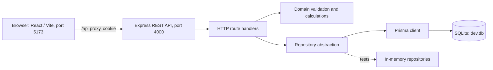
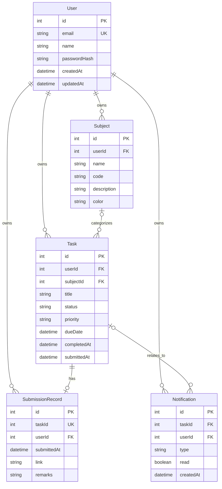

# Taskwell — Technical Documentation

## 1. Scope and architecture

Taskwell is a local full-stack TypeScript student task monitoring application. The **React SPA** consumes a **REST API** built with **Express**; the production-like local server persists data using **Prisma + SQLite**. The domain logic is separated from HTTP handlers and can be exercised using in-memory repositories in tests.

**Frontend:** React 18, TypeScript, React Router 6, Lucide icons, native CSS charts, Vite 6. Browser session uses HTTP-only cookie authentication and `credentials: include`. Dark-mode preference lives in `localStorage`. The UI has 10 routes, two public and eight protected.

**Backend:** Node.js, Express 5, TypeScript/tsx, zod dependency, bcryptjs, jsonwebtoken, helmet, cors, cookie-parser, Prisma 6 and SQLite. All authenticated repository queries are filtered by `userId`.

## 2. Directory responsibilities

| Location | Purpose |
|---|---|
| `frontend/src/main.tsx` / `App.tsx` | React bootstrap, route guards and route definitions |
| `frontend/src/auth.tsx` | Browser login state and `/auth/me` session refresh |
| `frontend/src/api.ts` | Typed JSON fetch wrapper and CSV download |
| `frontend/src/pages/` | Login/register, dashboard, tasks/subjects/calendar, submission/notification/report/settings pages |
| `frontend/src/components/` | Accessible modals, cards, navigation and status indicators |
| `backend/src/app.ts` | Auth, subject, task and dashboard endpoints; middleware wiring |
| `backend/src/http/` | Submission, notification and report endpoints |
| `backend/src/domain/` | Business rules and pure calculations |
| `backend/src/repositories/types.ts` | Repository interfaces and entity shapes |
| `backend/src/repositories/memory.ts` | In-memory test backend |
| `backend/src/repositories/prisma.ts` | Prisma/SQLite backend implementation |
| `backend/prisma/schema.prisma` | Database schema |
| `backend/tests/` | Unit and Supertest API integration tests |
| `frontend/e2e/` | Playwright browser test scenarios |

## 3. Data model / ERD

`Task.subjectId` is nullable and subject deletion sets it to `NULL`. Deleting a task cascades to its submission and notifications. `(userId,name)` is unique for subjects. `Task.status` and `priority` are strings checked by application validators, not database enums.

## 4. Authentication and data isolation

- `POST /api/auth/register`: password validated (8–72 chars, letter and number), bcrypt hashed (default 12 rounds); emails normalized lowercase.
- `POST /api/auth/login`: validates bcrypt password and signs a JWT with a 7-day expiration; token returned to API clients and set as an HTTP-only `SameSite=Lax` cookie. Cookie `secure` is only set if `NODE_ENV=production`.
- `POST /api/auth/logout`: clears the cookie. JWTs already copied to bearer clients **remain valid until they expire**; no revocation list exists.
- Other authenticated endpoints use Bearer authentication if specified, otherwise the cookie. Repository methods use the authenticated user's ID, preventing normal cross-user record access.
- `helmet()` adds HTTP security headers, `cors()` restricts the configured origin, and Express JSON parsing is limited to 100 KiB.

**Security improvements to consider before public deployment:** CSRF protection if using cross-site cookies, login rate limiting and account lockout, token revocation on logout/password change, strict input length checks for all task text fields, transactional submission updates, unique notification constraints, HTTPS deployment, structured error logging, secret management, database backups and monitoring. Do not claim production hardening has been completed.

## 5. REST API contract

All JSON endpoints use `{ "success": true, "data": { ... } }` on success, and `{ "success": false, "error": { "message": "...", "details": { ... } } }` on failure. The CSV route returns CSV bytes, not JSON.

| Method | Path | Action |
|---|---|---|
| POST | `/api/auth/register` | Create user; set cookie |
| POST | `/api/auth/login` | Authenticate; set cookie |
| POST | `/api/auth/logout` | Clear browser cookie |
| GET / PUT | `/api/auth/me` | Read/update own profile |
| PUT | `/api/auth/password` | Change password |
| GET / POST | `/api/subjects` | List/create own subjects |
| PUT / DELETE | `/api/subjects/:id` | Edit/delete subject |
| GET / POST | `/api/tasks` | List/create tasks (supports search, status, priority, subjectId, sort query) |
| GET / PUT / DELETE | `/api/tasks/:id` | Read/update/delete a task |
| GET | `/api/dashboard/summary` | Stats, upcoming, weekly progress, recent activity |
| GET / POST | `/api/submissions` | List task submission states / submit completed task |
| PUT | `/api/submissions/:id` | Edit submission link/remarks |
| GET | `/api/notifications` | Compute and list current notifications |
| PATCH | `/api/notifications/:id/read` | Mark one notification read |
| GET | `/api/reports/summary` | Completion/submission/subject/weekly statistics |
| GET | `/api/reports/export.csv` | Download CSV with formula neutralization |

**Typical workflow:** register → create subject → create task with `dueDate` in ISO 8601 → update status to `COMPLETED` → `POST /api/submissions` with numeric `taskId` → view report.

Task statuses: `PENDING`, `IN_PROGRESS`, `COMPLETED`, `SUBMITTED`. Priorities: `LOW`, `MEDIUM`, `HIGH`.

## 6. Date and calculation details

- Database values are UTC instants. Frontend `datetime-local` inputs are converted to UTC ISO strings for transport; display uses the browser's local timezone.
- An open task is `OVERDUE` when its due instant is earlier than now. Open tasks due within three UTC calendar days are `DUE_SOON`.
- Completion includes `COMPLETED` and `SUBMITTED`. `completionPercentage = round(completed / total * 100)` (0 for no tasks).
- Submissions exactly on the due instant count as `ON_TIME`; positive lateness is `ceil((submittedAt - dueDate) / one hour)`.
- Weekly progress is eight Monday-starting UTC weeks; categories are tasks created and tasks completed in each week.
- CSV quotes commas, quotes and line breaks; cells beginning with spreadsheet formula-significant characters are prefixed with a literal apostrophe to neutralize spreadsheet evaluation.

## 7. API and domain testing

The backend's original TDD evidence is retained under `evidence/tdd` and `docs/testing/TDD_EVIDENCE.md`. The existing suite contains 111 tests across 10 files under the *memory* repository configuration; tests against Prisma are activated by `RUN_PRISMA=1`. Do not count the same test running twice as unique test cases.

`verify-on-windows.ps1` installs backend packages, generates Prisma, applies migrations to `dev.db` and `test.db`, runs memory/Prisma integration tests, and runs coverage. It logs actual process output and exit codes to `evidence/integration-tests/`. The Playwright suite runs browser flows against separate `e2e.db`. The Postman collection can be run manually or with Newman.

## 8. Operational assumptions and known limitations

1. Notification candidate rows are written **when `/api/notifications` is fetched**; there is no background scheduler. Concurrent calls can create duplicates without a database uniqueness constraint.
2. Submission record creation and task status update are **two writes**, not one transaction. A failure between them can produce inconsistent state.
3. The system is single-instance/local by design and has no account email verification, reset-password flow, file uploads, or LMS integration.
4. The UI has no server-side pagination; it fetches tasks and filters the local array, appropriate for small student workloads only.
5. No build or runtime pass should be asserted without its actual logged result. Refer to the final audit.
